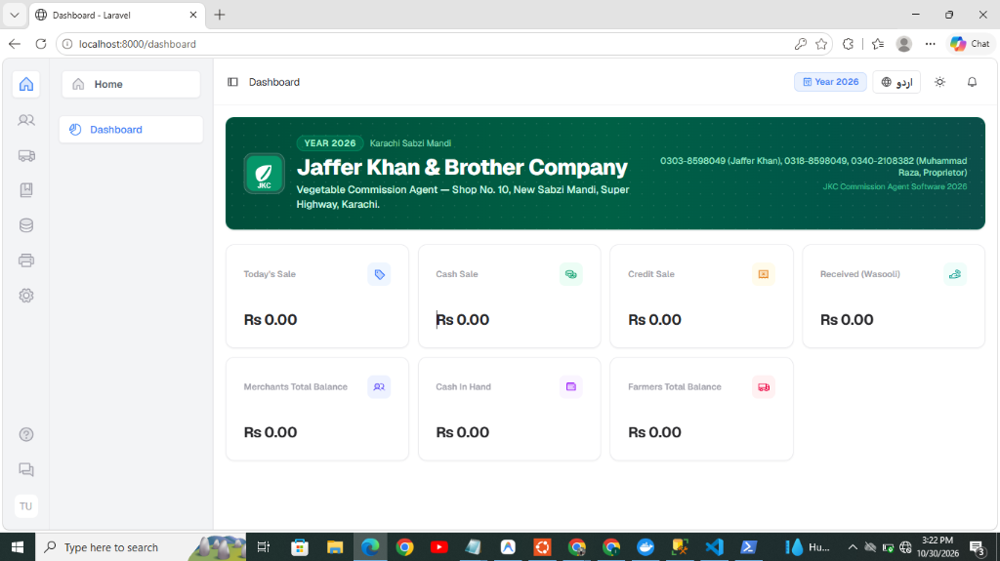
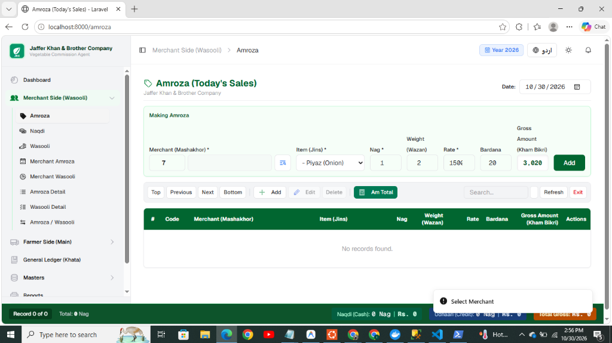

# 🥬 JKC Vegetable Commission Agent System
### جعفر خان اینڈ برادرز کمپنی (Jaffer Khan & Brother Company) — سبزی کمیشن ایجنٹ، کراچی

A specialized, bilingual (English & Urdu RTL) ERP & Commission Accounting software developed for Vegetable & Fruit Commission Agents (سبزی و فروٹ کمیشن ایجنٹ) operating in Subzi Mandi, Karachi. 

Built on top of **Laravel 12**, **React 19**, **Inertia.js**, **TypeScript**, and **Tailwind CSS v4**.

---

## 📸 Screenshots

### 1. Amroza (امروزہ / Daily Auction & Sales Register)
Fast keyboard-driven entry form with live calculation (`Nag × Rate + Bardana`), credit/cash segregation, action bar navigation, and live totals footer.



---

### 2. Code-based Merchant & Party Picker (فہرست / کوڈ سلیکٹر)
Keyboard search, instant code-to-name lookup, and modal list picker with current balance display.



---

## ✨ Core Modules & Capabilities

### 🌐 1. Bilingual & RTL Support (اردو / English)
- **Instant Toggle:** Toggle between English and Urdu (Nastaliq & Naskh Arabic typography) seamlessly without page reloads.
- **Full RTL/LTR Layout Alignment:** All forms, tables, modals, and print letterheads adapt dynamically to reading direction.
- **Double-Toggle Fidelity:** Guaranteed 100% preservation of original UI terms upon switching back and forth.

### 🏢 2. Master Records (بنیادی اندراجات)
- **Merchants (بیوپاری / خریدار):** Auto code allocation, Urdu/English names, contact details, opening balance, and live balance tracking. Code `1` reserved for **Naqdi (Cash Sales)**.
- **Farmers (زمیندار / کاشتکار):** Full farmer directory with affiliated marks and ledger integration.
- **Marks (مارکہ جات):** Multiple marks per farmer, including mark `0` for **خود (Self)**.
- **Items (اجناس / سبزیاں):** Products with default market rates, bardana charges, and metric units.
- **Areas (علاقہ جات):** Geographic tracking of farm origins and merchant routes.

### 💰 3. Merchant Side Operations (بیوپاری کھاتہ و فروخت)
- **Amroza Entry (امروزہ فروخت):** High-speed daily sales auction screen with shortcut-driven fields:
  - Line calculation: $\text{Gross} = (\text{Weight} \times \text{Rate}) + \text{Bardana}$ or $(\text{Nag} \times \text{Rate}) + \text{Bardana}$.
  - Instant Cash (نقدی) vs Credit (ادہاری) classification.
  - **Am Total (ام ٹوٹل):** Instant modal breaking down daily sales by merchant and by item.
- **Naqdi Screen (نقدی روزنامچہ):** Tracking cash recoveries against daily auction.
- **Wasooli Screen (وصولی اندراج):** Dynamic ledger recovery balancing:
  $$\text{Total Baqaya} = \text{Sabiqa} + \text{Amroza} - \text{Wasooli}$$
- **Reports (رپورٹس):**
  - Merchant Amroza Register (بیوپاری کا امروزہ)
  - Merchant Wasooli Register (بیوپاری وصولی)
  - Amroza Detail (امروزہ تفصیل)
  - Wasooli Detail (وصولی تفصیل)
  - Amroza / Wasooli Comparative Ledger (امروزہ و وصولی بیلنس)
  - All reports feature standard A4 browser print letterheads with Urdu typography.

---

## 🛠 Tech Stack

| Layer | Technology |
|---|---|
| **Backend Framework** | Laravel 12 (PHP 8.2+) |
| **Frontend Architecture** | React 19 + TypeScript |
| **Routing / SPA Glue** | Inertia.js v2 |
| **Styling & Icons** | Tailwind CSS v4, Lucide Icons, Phosphor Icons |
| **Internationalization** | react-i18next with self-hosted Noto Naskh & Nastaliq Urdu fonts |
| **Database** | SQLite / MySQL |

---

## ⚙️ Installation & Setup

### Prerequisites
- PHP >= 8.2 with `pdo_sqlite` or `pdo_mysql`, `mbstring`, `openssl`
- Composer 2.x
- Node.js >= 20.x & npm

### 1. Clone the Repository
```bash
git clone https://github.com/sudoleadsofficial-beep/pos-system.git
cd pos-system
```

### 2. Backend Configuration
```bash
composer install
cp .env.example .env
php artisan key:generate
```

Configure your `.env` database settings:
```env
DB_CONNECTION=sqlite
# Or MySQL:
# DB_CONNECTION=mysql
# DB_HOST=127.0.0.1
# DB_PORT=3306
# DB_DATABASE=jkc_pos
# DB_USERNAME=root
# DB_PASSWORD=
```

Run database migrations and seed default JKC master data:
```bash
php artisan migrate --seed
```

### 3. Frontend Assets
```bash
npm install --legacy-peer-deps
npm run build
```
*(Or use `npm run dev` for local hot module replacement).*

### 4. Run Development Server
```bash
php artisan serve
```

Access the system in your browser at: **`http://localhost:8000`**

---

## 📜 Business Rules & Logic Integrity
1. **Protected Master Codes:**
   - Merchant Code `1` is permanently reserved for Cash / Naqdi sales.
   - Farmer Mark `0` is reserved for Khud (خود).
2. **Double-entry Balance Continuity:**
   - Previous Balance (سابقہ) is computed dynamically from chronological sale and receipt ledger streams.
3. **No External PDF Engine Required:**
   - All print views, bills, and ledger summaries are optimized for standard desktop browser print dialogs (A4 format).

---

## 🏢 Organization
**Jaffer Khan & Brother Company (جعفر خان اینڈ برادرز کمپنی)**  
Vegetable Commission Agents, New Subzi Mandi, Super Highway, Karachi, Pakistan.
